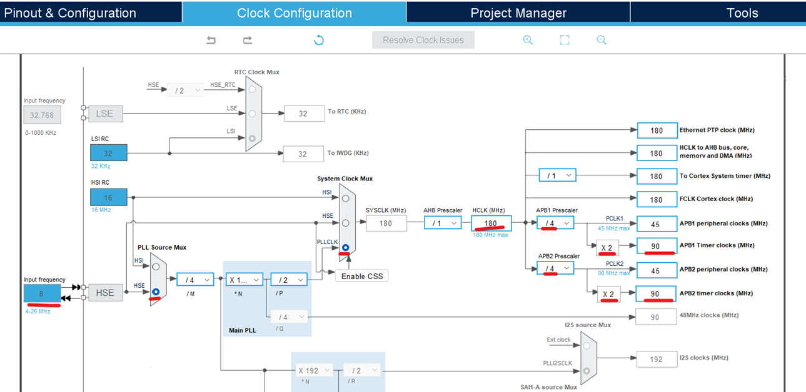
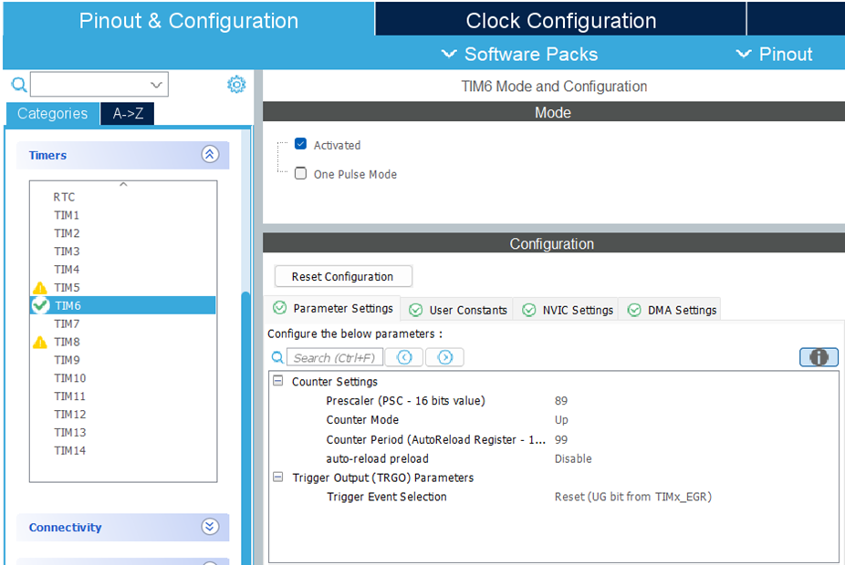
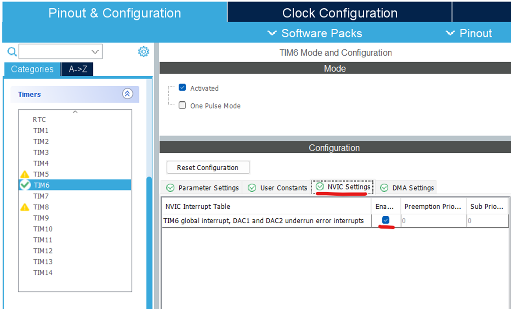
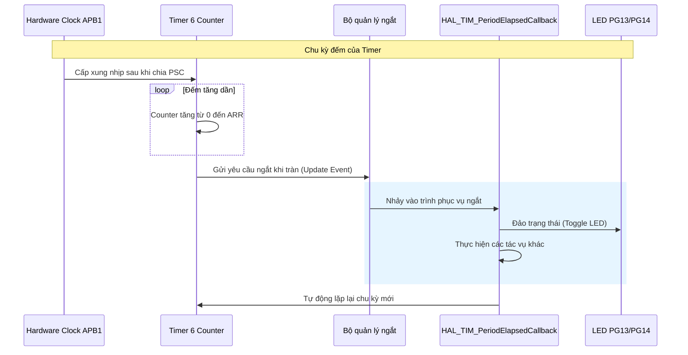

Dự án này thực hiện việc sử dụng **Timer 6** để tạo ra một sự kiện định kỳ (ví dụ: chớp tắt LED) mà không làm treo hệ thống. Đây là nền tảng để hiểu về cách quản lý thời gian thực trong vi điều khiển STM32. Cách sử dụng là:

- Chỉ cần quan sát led **LD4 màu đỏ nhấp nháy** tắt bật theo chu kì 1 giây

## Video

## 1. Nguyên lý hoạt động

Timer 6 là một **Basic Timer** (Bộ định thời cơ bản). Cách thức hoạt động của nó như sau:

1. **Clock Source**: Timer nhận xung nhịp từ nhánh ngoại vi APB1.
2. **Prescaler (PSC)**: Bộ chia tần số giúp giảm tốc độ đếm để phù hợp với yêu cầu.
3. **Auto-Reload Register (ARR)**: Giá trị tối đa mà Timer sẽ đếm đến.
4. **Update Event**: Khi bộ đếm (Counter) đạt đến giá trị ARR, nó sẽ tự động reset về 0 và phát ra một tín hiệu ngắt (Interrupt).

## 2. Cấu hình phần cứng

- **Kit**: STM32F429I-DISC1 (Discovery).
- **LED**: PG13 (Green) và PG14 (Red) thường được dùng để quan sát kết quả.
- **UART1**: Được dùng để gửi thông báo mỗi khi ngắt xảy ra (kết nối qua cổng Mini USB nhờ ST-Link VCP).

## 3. Thiết lập Timer 6 bằng CubeMX

1. Cấu hình System Clock (**SysTick**):

2. Cấu hình Timer 6 **TIM6**:

3. Kích hoạt ngắt cho Timer 6:

## 4. Sơ đồ luồng hoạt động (Mermaid)

## PHỤ LỤC: SO SÁNH VÀ PHÂN LOẠI TIMER (TIM1 - TIM6)

Hệ thống Timer trên STM32F429ZIT6 rất đa dạng. Việc chọn đúng Timer giúp tối ưu hóa tài nguyên và tránh xung đột với các thư viện hoặc hệ điều hành.

### 1. Bảng so sánh tính năng các bộ Timer

| Timer | Loại | Độ phân giải | Kênh (Channels) | Chức năng chính |
| :--- | :--- | :--- | :--- | :--- |
| **TIM1** | Advanced | 16-bit | 4 | PWM chuyên dụng cho motor, có Dead-time, Break input. |
| **TIM2** | General | 32-bit | 4 | Đếm Encoder, đo thời gian dài (nhờ 32-bit), tạo PWM. |
| **TIM3** | General | 16-bit | 4 | PWM thông dụng, Input Capture (đo tần số xung). |
| **TIM4** | General | 16-bit | 4 | Tương tự TIM3, thường dùng điều khiển ngoại vi nhẹ. |
| **TIM5** | General | 32-bit | 4 | Tương tự TIM2, dùng khi cần thêm một bộ đếm 32-bit. |
| **TIM6** | Basic | 16-bit | 0 | Chỉ đếm thời gian thuần túy, dùng cho ngắt định kỳ hoặc DAC. |

### 2. Timer nào dùng cho RTOS?

Trong các dự án sử dụng hệ điều hành thời gian thực (như FreeRTOS), việc quản lý Timer rất quan trọng:

- **SysTick (Mặc định cho RTOS):** - Đây là một timer hệ thống nằm bên trong lõi Cortex-M4.
  - **Nhiệm vụ:** Tạo ra nhịp đập (Tick) cho RTOS để quản lý việc chuyển đổi giữa các tác vụ (Task Switching).

- **TIM6 (Khuyên dùng làm Timebase cho HAL):**
  - Khi chạy FreeRTOS trên STM32, thư viện HAL của STMicroelectronics cũng cần một nguồn Tick riêng để hoạt động (cho các hàm như `HAL_Delay`, `HAL_GetTick`).
  - **Vấn đề:** Nếu cả HAL và RTOS cùng dùng chung SysTick, sẽ dễ xảy ra xung đột mức ưu tiên ngắt (Priority).
  - **Giải pháp:** ST khuyên người dùng chuyển **Timebase Source** của HAL sang một Timer ngoại vi khác. **TIM6** là lựa chọn tốt nhất vì:
        1. Nó là Basic Timer, cấu hình đơn giản.
        2. Nó không có chân xuất/nhập (IO), nên việc dùng nó làm Timebase sẽ không gây lãng phí các chân chức năng như PWM hay Encoder của các Timer khác (TIM1-TIM5).

### 3. Tóm tắt lựa chọn

- Cần điều khiển động cơ mạnh mẽ: Dùng **TIM1**.
- Cần đo thời gian cực chính xác/dài hoặc đọc Encoder: Dùng **TIM2/TIM5**.
- Cần tạo nhịp (Tick) hỗ trợ cho RTOS hoặc HAL: Dùng **TIM6**.
